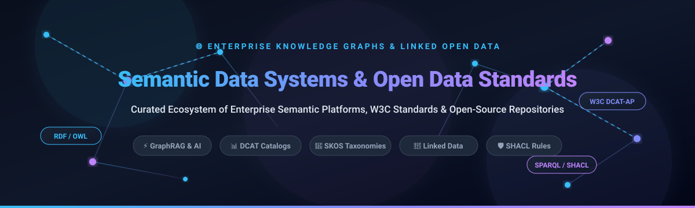

<div align="center">

<a href="https://github.com/ishandutta2007/Awesome-Awesome-Awesome"></a><a href="https://discord.gg/jc4xtF58Ve"></a>


<a href="https://github.com/ishandutta2007"></a>

<br/>
<br/>



# 🌐 Awesome Semantic Data Systems & Open Data Standards 🚀

### *A Curated Directory of Enterprise Knowledge Graphs, Semantic AI Platforms, W3C Standards & Open-Source Linked Data Infrastructure*

[](https://github.com/ishandutta2007/Awesome-Semantic-Data-Systems-Open-Data-Standards/pulls)
[](https://github.com/ishandutta2007/Awesome-Semantic-Data-Systems-Open-Data-Standards/graphs/commit-activity)
[](https://github.com/ishandutta2007/Awesome-Awesome-Awesome)

</div>

---

## 🧭 Executive Summary & SEO Overview

Welcome to the definitive **Semantic Data Systems and Open Data Standards** ecosystem tracker. Modern data architecture requires robust semantic interoperability to power **Enterprise Knowledge Graphs**, **GraphRAG (Retrieval-Augmented Generation)**, **Linked Open Data (LOD)**, and **federated data catalogs**.

This repository catalogs top commercial **SaaS platforms** and high-velocity **open-source software** implementing foundational standards established by the **World Wide Web Consortium (W3C)**, the **European Commission (DCAT-AP)**, and international standards bodies (ISO 25964):

- **Ontologies & Vocabularies:** RDF (Resource Description Framework), RDFS, OWL 2, SKOS, SKOS-XL, Schema.org
- **Query & Constraints:** SPARQL 1.1, SHACL (Shapes Constraint Language), ShEx (Shape Expressions)
- **Data Serialization & Formats:** JSON-LD 1.1, Turtle, TriG, N-Triples, RDF/XML, HDT
- **Data Catalog & Mapping:** DCAT, DCAT-AP, DCAT-US, R2RML, RML (RDF Mapping Language)

---

## 📊 Sector Overview & Market Dynamics

> [!NOTE]
> **Market Size & Growth:** The global Semantic Web and Knowledge Graph software market is estimated at **$2.71 Billion in 2025–2026** and is projected to expand to **$7.73+ Billion by 2030**, advancing at a robust compound annual growth rate (**CAGR of ~23.3% to 31.5%**).  
> **Market Fragmentation:** The sector remains **highly to moderately fragmented** rather than a winner-take-all monopoly, characterized by specialized graph-database vendors, semantic AI startups, and cloud conglomerates (AWS, Microsoft, ServiceNow, Progress) competing alongside widely adopted community-driven W3C open standards.

---

## 📑 Table of Contents

- [📊 Sector Overview & Market Dynamics](#-sector-overview--market-dynamics)
- [🏢 SaaS & Hosted Platforms](#-saas--hosted-platforms)
- [🔓 Open-Source GitHub Projects](#-open-source-github-projects)
- [💡 Framework Combinations for Custom Architectures](#-framework-combinations-for-custom-architectures)
- [📈 Star History](#-star-history)
- [🤝 Support](#-support)
- [🤝 How to Contribute](#-how-to-contribute)
- [⚖️ Disclaimer](#-disclaimer)

---

## 🏢 SaaS & Hosted Platforms

Below is the comparative breakdown of industry-leading enterprise SaaS platforms for semantic middleware, knowledge graph modeling, and data cataloging, sorted by company size (**Revenue / Market Valuation, Descending**):

| Product / Platform | Company / Backer | Company Scale (Valuation / Revenue) 🔽 | Pricing (Starting Paid Tier) | Free Tier / Evaluation Limits | Primary Semantic Capabilities |
| :--- | :--- | :--- | :--- | :--- | :--- |
| **[Progress Semaphore](https://progress.com)** | Progress Software Corporation (NASDAQ: PRGS) | **~$1.7B Market Cap** (~$1.0B ARR) | **Custom annual contract** (B2B enterprise quotes start typically ~$30,000–$50,000/yr) | **No perpetual free tier**; Guided enterprise Proof-of-Concept (PoC) & sandbox demo on request | Enterprise semantic AI, automated taxonomy classification, metadata orchestration, and ontology management. |
| **[data.world](https://data.world)** | ServiceNow (Acquired May 2025) / Venture-backed ($130M+ raised) | **~$350M Valuation** (at Series C) | **$12 / user / month** (Individual Pro); Enterprise catalog tiers start ~$50,000/yr | **Free Forever Tier**: Max 3 private projects/datasets, 100 MB per dataset, 1 GB total storage limit, 3 live tables | RDF-native cloud enterprise data catalog, knowledge graph discovery, data mesh governance, and virtualization. |
| **[Stardog](https://stardog.com)** | Stardog Union Inc. (Accenture Ventures, TenEleven) | **~$32.5M Raised** (~$14M ARR) | **Custom enterprise subscription**; Pay-as-you-go AWS/Azure Marketplace private offers | **Free Forever Tier (Stardog Cloud Free)**: Up to 1,000,000 graph edges, 3 active databases, shared hosting, community support (or 30-day cloud marketplace trial) | Virtual Enterprise Knowledge Graph, OWL 2 reasoning, SHACL constraint validation, SPARQL & semantic SQL querying. |
| **[Graphwise GraphDB](https://ontotext.com)** *(formerly Ontotext)* | Graphwise (Oakley Capital; Ontotext & SWC merger) | **~$18M+ ARR** (Oakley Capital majority stake) | **Custom per-core subscription**; Cloud Marketplace hourly compute licensing | **Free Forever Tier (GraphDB Free)**: Uncapped graph size/statements on 1 node, strictly capped at 2 concurrent query workers (free license key required) | Scalable W3C RDF 1.1 triplestore, SPARQL 1.1 query engine, RDF-star support, and high-performance GraphRAG pipelines. |
| **[Graphwise PoolParty](https://poolparty.biz)** *(formerly Semantic Web Co.)* | Graphwise (Oakley Capital; Ontotext & SWC merger) | **~$18M+ ARR** (Part of Graphwise group) | **$1,900 / month** (Cloud starter); On-premise server tiers ~$21,000–$44,000/yr | **No self-serve free plan**; 14-day to 30-day managed sandbox trial / Semantic Web Starter Kit PoC upon sales approval | Enterprise SKOS taxonomy management, ontology engineering, text extraction, and automated content tagging. |
| **[Franz AllegroGraph](https://allegrograph.com)** | Franz Inc. | **~$10M Est. Revenue** (Boutique private firm) | **Custom commercial license**; Cloud marketplace hourly compute rate for enterprise editions | **Free Forever Tier (Free Edition)**: Up to 5,000,000 RDF triples / statements, includes Gruff visualization tool, zero software license fee | Neuro-symbolic knowledge graph, RDF/SPARQL triple storage, integrated vector search, and FedShard distributed queries. |
| **[metaphactory](https://metaphacts.com)** | metaphacts GmbH (Digital Science / Holtzbrinck) | **~$5M ARR** (Digital Science subsidiary) | **Usage-based / instance-tiered pricing** via AWS/Azure Marketplace (Non-production vs. Production) | **14-day Free Trial** via AWS Marketplace (standard instance tier; automatically transitions to usage billing) | Low-code knowledge graph application platform, semantic data visualization, SPARQL interfaces, and human-in-the-loop curation. |
| **[TopBraid EDG](https://topquadrant.com)** | TopQuadrant Inc. | **~$4.1M ARR** (Private bootstrapped) | **Custom annual subscription** (Module- and user-based enterprise licensing) | **No perpetual free tier**; 30-day evaluation trial license provided upon qualification | Enterprise Data Governance (EDG) built natively on W3C SHACL, OWL, RDF, and SKOS asset collections. |
| **[Synaptica Graphite](https://synaptica.com/)** | Squirro (Acquired Synaptica July 2024) | **Private / Undisclosed** (Squirro subsidiary) | **Custom annual subscription** based on taxonomy assets and seat count | **No perpetual free tier**; Structured enterprise Proof-of-Concept (PoC) pilot on customer dataset upon consultation | Enterprise Knowledge Organization System (KOS), ISO 25964 taxonomy/thesaurus governance, and ontology publishing. |
| **[Cinchapi](https://cinchapi.com/)** | Cinchapi Inc. | **Seed Stage / Private** (Founder-led) | **Custom enterprise subscription** based on real-time event pipeline volume | **No self-serve free tier**; Guided interactive product sandbox and proof-of-value trial on demo request | Operational AI knowledge layer, real-time graph unification, dynamic schema management, and enterprise company-brain workflows. |

---

## 🔓 Open-Source GitHub Projects

The following table presents premier open-source repositories for linked data publishing, DCAT catalogs, SKOS taxonomy editors, triple stores, and semantic modeling frameworks, ranked by GitHub_Stars_Count (**Stargazers Count, Descending**):

| Repository / Project | Stargazers ⭐ | Primary Focus & Specification Compliance | Core Tech Stack | Description |
| :--- | :---: | :--- | :--- | :--- |
| **[OpenMetadata](https://github.com/open-metadata/OpenMetadata)** | [](https://github.com/open-metadata/OpenMetadata/stargazers) | Metadata Graph & Data Governance | Java / Python / React | Unified context and metadata platform defining open standards for data governance, schemas, and semantic lineage. |
| **[DataHub](https://github.com/datahub-project/datahub)** | [](https://github.com/datahub-project/datahub/stargazers) | Enterprise Metadata Graph | Python / Java / React | Extensible metadata search and discovery platform utilizing an underlying graph model to map business semantics. |
| **[ODS (Osmantic)](https://github.com/Osmantic/ODS)** | [](https://github.com/Osmantic/ODS/stargazers) | Self-Hosted Local AI & Semantic Stack | Python / TypeScript | Open-source deployment system and local AI data stack unifying retrieval, search, and private semantic infrastructure. |
| **[Schema.org](https://github.com/schemaorg/schemaorg)** | [](https://github.com/schemaorg/schemaorg/stargazers) | Web Vocabularies & Microdata | Python / RDF | Official source schemas and validation tooling for web-scale structured data, JSON-LD, and RDF vocabulary definitions. |
| **[CKAN](https://github.com/ckan/ckan)** | [](https://github.com/ckan/ckan/stargazers) | DCAT Open Data Portals | Python / PostgreSQL | The world’s premier open-source data management system powering national, regional, and municipal open data portals. |
| **[RDFLib](https://github.com/RDFLib/rdflib)** | [](https://github.com/RDFLib/rdflib/stargazers) | W3C RDF Core Library | Python | Foundational Python library for parsing, serializing, manipulating, and querying RDF graphs (Turtle, JSON-LD, SPARQL). |
| **[Oxigraph](https://github.com/oxigraph/oxigraph)** | [](https://github.com/oxigraph/oxigraph/stargazers) | SPARQL 1.1 Graph Database | Rust / RocksDB | Lightweight, high-speed SPARQL 1.1 triplestore implemented in Rust with RocksDB persistence, Python, and JS bindings. |
| **[JSON-LD.js](https://github.com/digitalbazaar/jsonld.js)** | [](https://github.com/digitalbazaar/jsonld.js/stargazers) | W3C JSON-LD 1.1 Processor | JavaScript / Node.js | Official reference implementation of W3C JSON-LD 1.1 for expanding, compacting, and flattening linked data in JavaScript. |
| **[Protégé](https://github.com/protegeproject/protege)** | [](https://github.com/protegeproject/protege/stargazers) | OWL 2 & Ontology Engineering | Java / Swing | Gold-standard open-source ontology editor and knowledge modeling environment supporting OWL 2 and DL reasoners. |
| **[Apache Jena](https://github.com/apache/jena)** | [](https://github.com/apache/jena/stargazers) | Semantic Web & TDB2 Triplestore | Java | Foundational Java framework and Fuseki SPARQL server for building industrial-strength semantic web applications. |
| **[Ontop](https://github.com/ontop/ontop)** | [](https://github.com/ontop/ontop/stargazers) | Virtual Knowledge Graphs (VKG) | Java | Virtual knowledge graph platform mapping SQL relational databases into virtual RDF graphs using R2RML and SPARQL. |
| **[Virtuoso Open-Source](https://github.com/openlink/virtuoso-opensource)** | [](https://github.com/openlink/virtuoso-opensource/stargazers) | Multi-Model Triplestore & LOD Server | C / C++ | High-performance multi-model RDBMS and RDF triple store powering DBpedia and the global Linked Open Data cloud. |
| **[Frictionless Data (Python)](https://github.com/frictionlessdata/frictionless-py)** | [](https://github.com/frictionlessdata/frictionless-py/stargazers) | Tabular Open Data Standards | Python | Framework implementing the Data Package and Table Schema specifications for validating and publishing open data. |
| **[LinkML](https://github.com/linkml/linkml)** | [](https://github.com/linkml/linkml/stargazers) | Semantic Data Modeling Language | Python / YAML | General-purpose data modeling language that compiles expressive YAML schemas into OWL, SHACL, JSON-LD, and SQL. |
| **[Eclipse RDF4J](https://github.com/eclipse-rdf4j/rdf4j)** | [](https://github.com/eclipse-rdf4j/rdf4j/stargazers) | Enterprise RDF for Java | Java | Robust Java framework for scalable RDF storage, SPARQL querying, SHACL validation, and transactional graph operations. |
| **[DKAN](https://github.com/GetDKAN/dkan)** | [](https://github.com/GetDKAN/dkan/stargazers) | DCAT-US Open Data Portal | PHP / Drupal | Community-driven open data catalog platform tailored for government agencies with built-in Project Open Data schemas. |
| **[pySHACL](https://github.com/RDFLib/pySHACL)** | [](https://github.com/RDFLib/pySHACL/stargazers) | W3C SHACL Validator | Python | Comprehensive Python validator for W3C Shape Constraint Language (SHACL) validating RDF graph integrity. |
| **[Skosmos](https://github.com/NatLibFi/Skosmos)** | [](https://github.com/NatLibFi/Skosmos/stargazers) | SKOS Vocabulary Browser | PHP / JavaScript | Web-based vocabulary browser and publishing portal for controlled vocabularies, taxonomies, and thesauri using SKOS. |
| **[RMLMapper](https://github.com/RMLio/rmlmapper-java)** | [](https://github.com/RMLio/rmlmapper-java/stargazers) | RML Mapping Language Engine | Java | Reference engine executing RML rules to transform heterogeneous CSV, JSON, and XML sources into Linked Data triples. |
| **[SANSA Stack](https://github.com/SANSA-Stack/SANSA-Stack)** | [](https://github.com/SANSA-Stack/SANSA-Stack/stargazers) | Distributed Big Data Semantic Stack | Scala / Spark | Distributed big data processing and machine learning engine for massive RDF datasets built on Apache Spark and Flink. |
| **[LodView](https://github.com/LodLive/LodView)** | [](https://github.com/LodLive/LodView/stargazers) | Linked Data URI Dereferencer | Java / Spring | Web application for dereferencing RDF URIs with content negotiation, interactive HTML viewing, and SPARQL integration. |
| **[ShEx.js](https://github.com/shexjs/shex.js)** | [](https://github.com/shexjs/shex.js/stargazers) | Shape Expressions (ShEx) Validator | JavaScript | Complete JavaScript implementation for validating, converting, and transforming RDF data using Shape Expressions (ShEx). |
| **[SPARQL Transformer](https://github.com/D2KLab/sparql-transformer)** | [](https://github.com/D2KLab/sparql-transformer/stargazers) | JSON-to-SPARQL Query Bridge | JavaScript / Python | Developer utility allowing web engineers to query SPARQL endpoints using simple JSON structures and obtain JSON-LD. |
| **[Piveau Hub](https://github.com/piveau-data/piveau-hub)** | [](https://github.com/piveau-data/piveau-hub/stargazers) | DCAT-AP European Data Portal | Java / Vert.x | Modular metadata catalog engine powering the official European Data Portal built strictly on W3C DCAT-AP standards. |

---

## 💡 Framework Combinations for Custom Architectures

To build an enterprise-grade, standards-compliant semantic platform entirely with open-source tools:

```
┌────────────────────────────────────────────────────────┐
│            1. Data Portal & Presentation               │
│     CKAN / Piveau Hub / DKAN / LodView / Skosmos       │
└──────────────────────────┬─────────────────────────────┘
                           │ DCAT-AP / SPARQL Endpoint
┌──────────────────────────▼─────────────────────────────┐
│          2. Modeling, Schemas & Validation             │
│      LinkML  ◄──►  Protégé  ◄──►  pySHACL / ShEx       │
└──────────────────────────┬─────────────────────────────┘
                           │ R2RML / RML Mappings
┌──────────────────────────▼─────────────────────────────┐
│             3. Ingestion & Virtualization              │
│            Ontop (VKG)  /  RMLMapper-Java              │
└──────────────────────────┬─────────────────────────────┘
                           │ RDF Triples / Quads
┌──────────────────────────▼─────────────────────────────┐
│               4. Storage & Query Engine                │
│    Apache Jena Fuseki  /  Oxigraph  /  Virtuoso        │
└────────────────────────────────────────────────────────┘
```

---

## 📈 Star History

[](https://star-history.dera.page/#ishandutta2007/Awesome-Semantic-Data-Systems-Open-Data-Standards&type=date&legend=top-left)
[](https://www.star-history.com/#ishandutta2007/Awesome-Semantic-Data-Systems-Open-Data-Standards&type=date&legend=top-left)

---

## 🤝 Support

Thank you for exploring this curated repository! If you find this ecosystem guide helpful for your semantic data projects, knowledge graphs, or open data initiatives, please consider supporting the project:

- ⭐ **Star** this repository to help others discover it!
- 🍴 **Fork** and contribute new tools or update existing entries.
- 📣 **Share** with your network, team, ontologists, and data engineers.
- ☕ **Buy me a coffee / Sponsor:** Support ongoing maintenance via the [GitHub Sponsor Dashboard](https://github.com/sponsors/ishandutta2007).

Your support is deeply appreciated and directly aids in keeping this open knowledge resource accurate, vibrant, and up-to-date! 🙌

---

## 🤝 How to Contribute

We welcome contributions from the open data, knowledge graph, and semantic web communities!

1. **Fork the repository** on GitHub.
2. **Add or update an entry** in `README.md` keeping the tabular structure.
3. **Ensure strict adherence to criteria**:
   - For SaaS products: include specific pricing starting tiers and exact free tier/trial limits.
   - For open-source tools: include the official repo link, accurate GitHub_Stars_Badge (`style=social&color=white`), and brief capability summary.
4. **Submit a Pull Request** with a descriptive title and concise summary of changes.

---

## ⚖️ Disclaimer

- This repository is a **community-curated index** created for research, technical architecture reference, and educational purposes. Inclusion does not constitute a formal commercial endorsement.
- All product names, logos, and trademarks are the property of their respective owners.
- Semantic systems deployed in enterprise or civic environments should rigorously implement W3C security standards, rate-limiting on public SPARQL query endpoints, and compliance with data protection regulations (e.g., GDPR, CCPA).

---

<div align="center">

**Curated with ❤️ for ontologists, knowledge engineers, data stewards, and semantic web architects worldwide.**

[⬆ Back to Top](#-awesome-semantic-data-systems-open-data-standards-)

</div>
